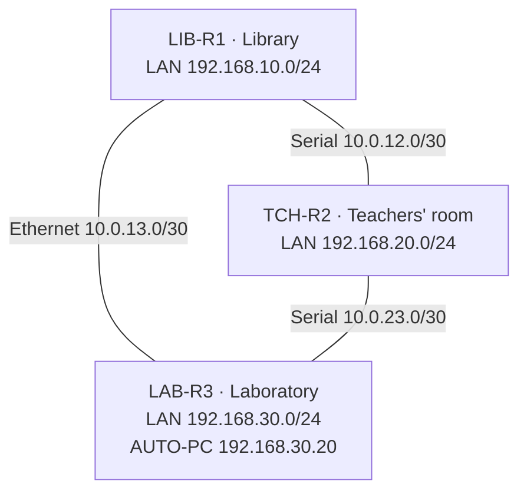
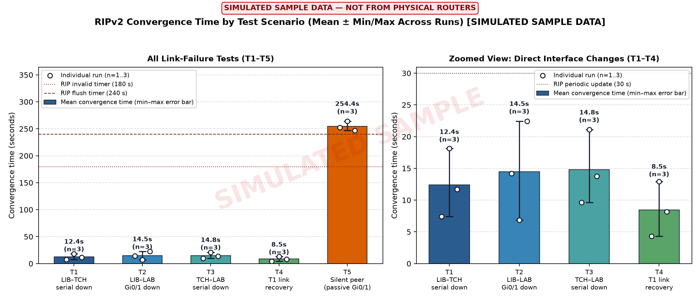

# RIPv2 Dynamic Routing & Python Network Automation

A three-room enterprise/campus network (Library, Teachers' room, Laboratory) on Cisco 2901 routers running RIPv2, paired with a Python SSH automation and measurement suite that pushes configurations, snapshots routing tables, monitors route transitions in real time, and measures RIPv2 convergence across physical and silent link failures.

## Network Topology

Three routers in a redundant triangle topology so every LAN has two distinct paths to every other LAN. One inter-router link is Gigabit Ethernet; two are 64 kbps Serial links.



| Router | LAN (`G0/0`) | Inter-Router Links |
|---|---|---|
| `LIB-R1` | `192.168.10.1/24` | `S0/0/0` to `TCH-R2` (DCE), `G0/1` to `LAB-R3` |
| `TCH-R2` | `192.168.20.1/24` | `S0/0/0` to `LIB-R1`, `S0/0/1` to `LAB-R3` (DCE) |
| `LAB-R3` | `192.168.30.1/24` | `G0/1` to `LIB-R1`, `S0/0/0` to `TCH-R2` |

Each router runs `router rip`, `version 2`, `no auto-summary`, with its LAN configured as `passive-interface`. Full router/switch configurations are in [`configs/source/`](configs/source/) and the architecture documentation is in [`docs/Part1-Network-Design-and-RIP-Configuration.pdf`](docs/Part1-Network-Design-and-RIP-Configuration.pdf).

---

## Convergence Analysis Preview



---

## Repository Layout

```text
configs/source/     Paste-in configs for the 3 Cisco 2901 routers and 3 Cisco 2960 switches
configs/exports/    Running-config exports from the configured devices
configs/push/       Config snippets for push_config.py (RIP block, timestamps, T5 silent failure)
topology/           Cisco Packet Tracer (.pkt) file and network topology diagrams
scripts/            Python SSH automation, convergence monitoring, simulation & plotting suite
tests/              Pytest unit test suite for routing-table and debug-log parsers (runs offline)
data/snapshots/     JSON routing-table snapshots (before/after link failures)
data/routes.csv     Structured routing table records across experiment runs
data/debug_logs/    Router debug captures and parsed timeline CSVs
data/monitor_logs/  1 Hz polling convergence logs
data/charts/        Generated convergence comparison and timeline charts
docs/               Network design documentation and technical guide
```

---

## Python Automation & Measurement Suite

| Script | Purpose |
|---|---|
| [`inventory.py`](scripts/inventory.py) | Router inventory and Netmiko/SSH `connect(name)` interface |
| [`connect_test.py`](scripts/connect_test.py) | Verifies SSH reachability and hostname state across all 3 routers |
| [`push_config.py`](scripts/push_config.py) | Pushes configuration snippets over SSH and saves running-config to NVRAM |
| [`get_routes.py`](scripts/get_routes.py) | Snapshots `show ip route rip` on every router to JSON and CSV |
| [`compare_routes.py`](scripts/compare_routes.py) | Diffs two routing snapshots (routes added, removed, or metric/next-hop changed) |
| [`capture_rip_debug.py`](scripts/capture_rip_debug.py) | Manages router log buffers (`debug ip rip` / `debug ip routing`) and extracts captures |
| [`monitor_convergence.py`](scripts/monitor_convergence.py) | Polls routers at 1 Hz during fault injection to record exact route-transition times |
| [`parse_rip_debug.py`](scripts/parse_rip_debug.py) | Parses `show logging` millisecond timestamps to compute control-plane convergence |
| [`run_experiment.py`](scripts/run_experiment.py) | End-to-end guided runner for test scenarios `T0`–`T5` |
| [`sim_router.py`](scripts/sim_router.py) | Offline Cisco IOS & RIPv2 timer simulator for validating measurement pipelines without hardware |
| [`visualize.py`](scripts/visualize.py) | Generates Matplotlib convergence comparison charts and event timelines |

---

## Quick Start

Requires Python 3.10+.

```bash
pip install -r requirements.txt
python -m pytest
```

### Usage Examples

```bash
# Verify SSH connectivity to all 3 routers
python scripts/connect_test.py

# Enable millisecond debug timestamps on all routers
python scripts/push_config.py configs/push/timestamps.txt all

# Take before/after snapshots and diff routing changes
python scripts/get_routes.py T0-baseline
python scripts/compare_routes.py T1-before T1-after

# Parse debug logs and generate convergence charts
python scripts/parse_rip_debug.py data/debug_logs/T1-run1_LIB-R1.txt --network 192.168.20.0/24 --metric 2
python scripts/visualize.py
```

---

## Link-Failure Test Matrix

| Test | Fault Injected | Expected Routing Behavior |
|---|---|---|
| **T0 Baseline** | All links up | Every remote LAN reachable at hop count (metric) `1` |
| **T1 Direct Serial Down** | `shutdown` on `LIB-R1 S0/0/0` | `LIB-R1` reroutes `192.168.20.0/24` via `LAB-R3` at metric `2` (triggered update) |
| **T2 Ethernet Down** | `shutdown` on `LIB-R1 G0/1` | `LIB-R1` reroutes `192.168.30.0/24` via `TCH-R2` at metric `2` |
| **T3 Secondary Serial Down** | `shutdown` on `TCH-R2 S0/0/1` | `TCH-R2` reroutes `192.168.30.0/24` via `LIB-R1` at metric `2` |
| **T4 Link Recovery** | `no shutdown` on `LIB-R1 S0/0/0` | Direct 1-hop route (`metric 1`) preempts the 2-hop backup path |
| **T5 Silent Failure** | `passive-interface G0/1` on `LAB-R3` | No carrier drop; `LIB-R1` waits for RIP invalid + flush timers (~180–240 s) |
