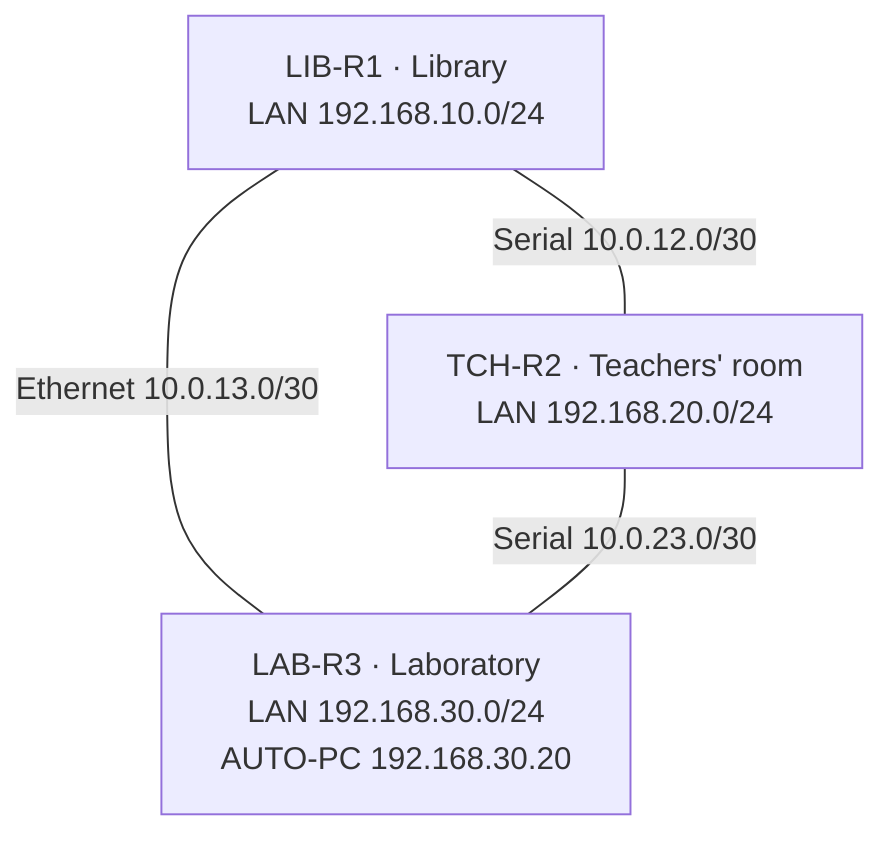
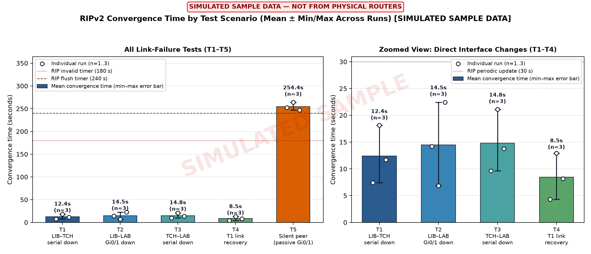

# rip-network-automation

[](https://github.com/al9eri/rip-network-automation/actions/workflows/ci.yml)
[](https://opensource.org/licenses/MIT)

Python SSH automation (Netmiko) and RIPv2 convergence timing harness for a 3-router Cisco 2901 lab topology.

Deploys router configs over SSH, polls `show ip route rip` at 1 Hz during link-failure tests, parses millisecond `debug ip rip` logs, and measures failover recovery (~25.5 s mean recovery on direct link failures vs. ~180-240 s timer expiry on silent drops).

## Topology

Three Cisco 2901 routers wired in a triangle (one Gigabit Ethernet link, two 64 kbps Serial links) so every LAN has a primary and backup route:



| Router | LAN (`G0/0`) | Inter-Router Links |
|---|---|---|
| `LIB-R1` | `192.168.10.1/24` | `S0/0/0` to `TCH-R2` (DCE), `G0/1` to `LAB-R3` |
| `TCH-R2` | `192.168.20.1/24` | `S0/0/0` to `LIB-R1`, `S0/0/1` to `LAB-R3` (DCE) |
| `LAB-R3` | `192.168.30.1/24` | `G0/1` to `LIB-R1`, `S0/0/0` to `TCH-R2` |

Each router runs `router rip`, `version 2`, `no auto-summary`, with its LAN set as `passive-interface`. Base router/switch configs live in [`configs/source/`](configs/source/) and architecture notes are in [`docs/Part1-Network-Design-and-RIP-Configuration.pdf`](docs/Part1-Network-Design-and-RIP-Configuration.pdf).



## Running tests & scripts

Requires Python 3.10+.

```bash
pip install -r requirements.txt
python -m pytest
```

The unit tests run offline against captured router outputs and `scripts/sim_router.py`. Against live routers:

```bash
python scripts/connect_test.py                          # verify SSH across all 3 routers
python scripts/push_config.py configs/push/timestamps.txt all
python scripts/get_routes.py T0-baseline                # snapshot show ip route rip -> JSON/CSV
python scripts/compare_routes.py T1-before T1-after     # diff snapshots
python scripts/parse_rip_debug.py data/debug_logs/T1-run1_LIB-R1.txt --network 192.168.20.0/24 --metric 2
python scripts/visualize.py                             # plot convergence charts into data/charts/
```

Full experiment runner (`T0`-`T5`): `python scripts/run_experiment.py`.

## Fault scenarios (`T0`-`T5`)

| Test | Fault Injected | Routing Behavior |
|---|---|---|
| `T0` Baseline | All links up | Every remote LAN at metric `1` |
| `T1` Direct Serial Down | `shutdown` on `LIB-R1 S0/0/0` | `LIB-R1` reroutes `192.168.20.0/24` via `LAB-R3` (metric `2`, triggered update) |
| `T2` Ethernet Down | `shutdown` on `LIB-R1 G0/1` | `LIB-R1` reroutes `192.168.30.0/24` via `TCH-R2` (metric `2`) |
| `T3` Secondary Serial Down | `shutdown` on `TCH-R2 S0/0/1` | `TCH-R2` reroutes `192.168.30.0/24` via `LIB-R1` (metric `2`) |
| `T4` Link Recovery | `no shutdown` on `LIB-R1 S0/0/0` | Direct 1-hop route preempts backup |
| `T5` Silent Failure | `passive-interface G0/1` on `LAB-R3` | No carrier drop; waits for RIP invalid + flush timers (~180-240 s) |
